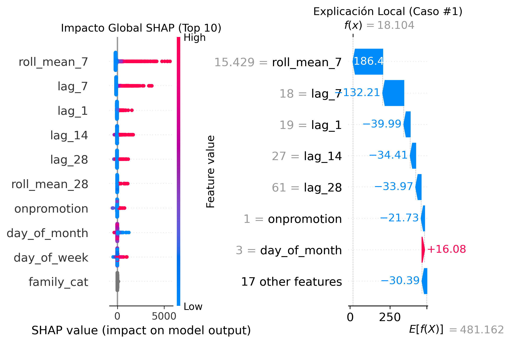

# Advanced Retail Demand Forecasting & Inventory Intelligence

Sistema end-to-end de Ciencia de Datos desarrollado sobre el dataset público de referencia **Corporación Favorita (Kaggle)** (~3M de registros diarios across 54 tiendas y 33 familias de productos) para predecir la demanda diaria y traducir la incertidumbre predictiva en políticas óptimas de reabastecimiento (**Safety Stock**, **ROP** y **EOQ**).

## Arquitectura del Pipeline

1. **Data Acquisition & Validation (`Polars`):** Integración de ventas históricas, maestros de tiendas, promociones, feriados y precios del petróleo, con auditoría de nulos, duplicados y clasificación de perecibilidad.
2. **Exploratory Data Analysis (`SciPy` & `Plotly`):** Detección de anomalías mediante Z-Score móvil, prueba no paramétrica de impacto promocional (Mann-Whitney U) y segmentación de intermitencia bajo la matriz Syntetos-Boylan ($ADI$ vs. $CV^2$).
3. **Feature Engineering (`Polars`):** Creación de rezagos (`lag_1`, `7`, `14`, `28`), ventanas móviles desplazadas (`roll_mean`, `roll_std`), variables cíclicas de calendario, días de pago y ratios de tendencia sin *data leakage*.
4. **Model Development & Backtesting (`StatsForecast`, `Statsmodels`, `XGBoost`, `LightGBM`):** Validación temporal estricta evaluando MAE, RMSE, WAPE, MASE y Forecast Bias.
5. **Hyperparameter Optimization (`Optuna`):** Búsqueda bayesiana sobre validación cruzada temporal priorizando precisión y estabilidad entre folds.
6. **Probabilistic Forecasting:** Estimación de cuantiles (**P10**, **P50**, **P90**) evaluados mediante cobertura real y *Pinball Loss*.
7. **Inventory Intelligence:** Cálculo dinámico de *Safety Stock*, *Reorder Point* (ROP) y *Economic Order Quantity* (EOQ), simulando 15 días de operación frente a una política estática tradicional.
8. **Explainability (`SHAP`):** Auditoría global y local de impulsores de demanda e impacto financiero simulado.

---

## Resultados Clave

### Precisión y Calibración Probabilística
* **Mejor Modelo:** `LightGBM` optimizado con `Optuna` alcanzando un **WAPE de 14.94%**.
* **Incertidumbre Cuantílica:** Cobertura real del **78.60%** dentro del intervalo `[P10 – P90]` (alineada al objetivo nominal del 80%).
* **Principales Impulsores (SHAP):** Inercia móvil de 7 días (`roll_mean_7`), rezagos semanales (`lag_7`, `lag_1`), actividad promocional (`onpromotion`) y estacionalidad de calendario.



### Impacto Financiero Simulado (Horizonte 15 Días)

| Política de Abastecimiento | Capital Inmovilizado Diario | Variación Capital | Unidades en Quiebre |
| :--- | :---: | :---: | :---: |
| **Estática (Regla Fija)** | $36,225,941 | — | 609 |
| **ML Probabilística (ROP / EOQ)** | $15,918,079 | **−56.06% (−$20.31M/día)** | 30,691 |

> **Insight de Negocio:** La política estática mantenía un sobrestock masivo para blindar el nivel de servicio. El enfoque probabilístico libera **$20.31M diarios** en capital de trabajo y permite calibrar el factor de servicio ($Z$) según la rentabilidad y perecibilidad de cada categoría.

---

## Ejecución

1. Clona el repositorio e instala las dependencias:
   ```bash
   git clone [https://github.com/IamGian18/retail-demand-forecasting-inventory-intelligence.git](https://github.com/IamGian18/retail-demand-forecasting-inventory-intelligence.git)
   cd retail-demand-forecasting-inventory-intelligence
   pip install -r requirements.txt
   ```
2. Descarga `store-sales-time-series-forecasting.zip` desde Kaggle y ejecuta el notebook `01_demand_forecasting_inventory_pipeline.ipynb` en Google Colab o entorno local.
